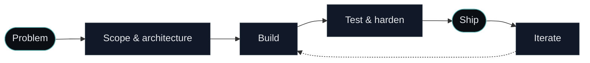

<!--
  Invariance | GitHub organisation profile
  Place this file at: .github/profile/README.md (inside a public repo named ".github")
  Replace every [PLACEHOLDER] before publishing.
-->

<picture>
  <source media="(prefers-color-scheme: dark)" srcset="[LOGO-DARK-URL]">
  <source media="(prefers-color-scheme: light)" srcset="[LOGO-LIGHT-URL]">
  
</picture>

 
 

 

 

> **in·var·i·ance** (n.)  
> *The property of remaining unchanged under transformation.*  
> We build systems that hold.

 

---

## What we do

Invariance is a specialised software company. We design and build software that has to work, every time, under load, in production, for people who depend on it.

Our focus is high-end web applications: management systems, client platforms, e-commerce, internal tooling and the infrastructure underneath. Everything is built custom. No page builders, no templates, no off-the-shelf shortcuts that break the moment a client needs something real.

<table>
  <tr>
    <td width="33%" valign="top">
      <h3 align="center">🏗️ Engineering</h3>
      
Full-stack web applications built from the ground up. Clean architecture, typed end to end, designed to be maintained for years.

    </td>
    <td width="33%" valign="top">
      <h3 align="center">🧪 R&D</h3>
      
Internal products and experiments that we take from idea to MVP fast, then harden into something people pay for.

    </td>
    <td width="33%" valign="top">
      <h3 align="center">🎯 Client work</h3>
      
Select assignments for businesses that need software built right, with a direct line to the engineers who build it.

    </td>
  </tr>
</table>

 

## Products

| Product | Description | Status |
|---|---|---|
| **[Kniply](https://kniply.nl)** | Management platform for barbershops. Bookings, clients and operations in one system, sold as a subscription. |  |
| **[PROJECT-2]** | [One-line description of the next product.] |  |
| **Undisclosed** | We don't announce everything we're working on. |  |

 

## How we work

<b>Principles we don't compromise on</b>

 

- **Custom over configured.** If it matters, we write it ourselves.
- **Ownership.** Clients own their code, their data and their infrastructure. No lock-in.
- **Small team, direct contact.** You talk to the people who write the code.
- **Quiet by default.** We don't publish client work unless the client wants us to.
- **Built to last.** Every system is designed to be understood and extended by whoever comes after us.

<b>Engagement model</b>

 

1. **Intake.** A short conversation about what you need and why.
2. **Proposal.** Fixed scope, fixed price, clear milestones.
3. **Build.** Milestone-based delivery with working software at every step.
4. **Handover.** Documentation, source code and a walkthrough. Optional maintenance.

 

## Stack

The stack follows the problem, not the other way around. This is what we reach for most often.

 

## Activity

 

## Team

| | |
|:---:|:---:|
| <a href="https://github.com/[HANDLE-1]"> <b>[Name]</b></a> Chief Executive Officer | <a href="https://github.com/jaikishanF"> <b>[Name]</b></a> Chief Executive Officer |

 

## Contact

Have a problem that needs real software behind it?

 

---

Invariance · Registered in the Netherlands · KvK [NUMBER]
 
© 2026 Invariance. All rights reserved.

